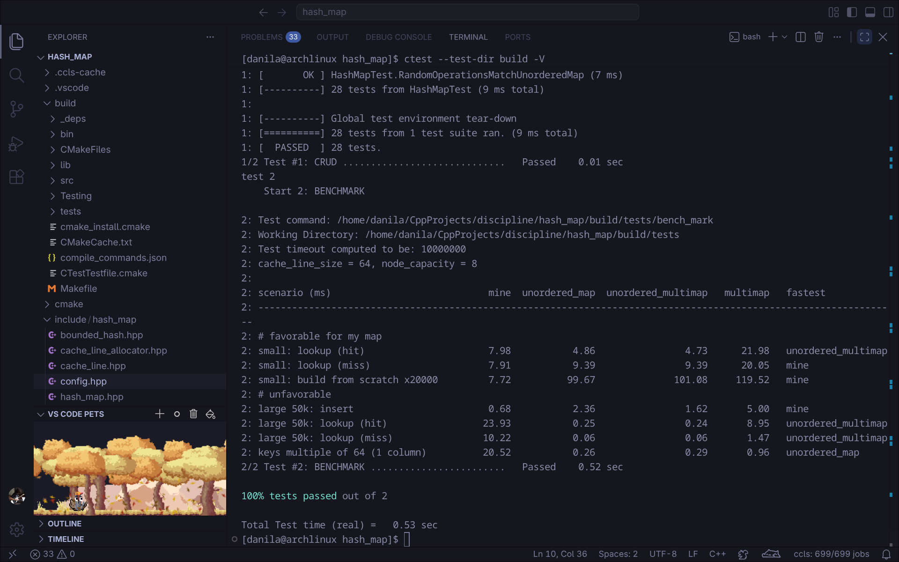

# Hash map

## About the project

I was interested in _CMake_, _gtest_ and testing in general. To explore these tools I had to start a project, so I picked a hash map. I'm watching a blogger who talks about different benchmarks and optimizations. [He](https://www.youtube.com/@MrTeamlead) uses _Rust_.

## The Point

Mr. Teamlead has been talking about SoA (struct of arrays) and cache hits. I was trying to mix SoA and caches somehow. The purpose of the project was to improve my code infrastructure skills, so I was free to implement this hash map as I liked:

1. Template parameters:
```C++
template <class K, class T, class Hash = BoundedHash<K>,
          class KeyEqual = std::equal_to<K>,
          class Allocator = CacheLineAllocator<CacheLine>>
class HashMap;  // namespace hash_map
```
I was referencing the real `std::unordered_map` implementation (but in the wrong way)... Don't pay attention to `hash_map::CacheLineAllocator`, I just tried to make a custom allocator. And ignore `hash_map::BoundedHash` too: it's a special hasher that follows the contract _"just hash objects into a bounded segment with a uniform distribution"_. You can try to make your own hasher, btw. But `hash_map::CacheLineAllocator` is the most ordinary thing here: useless, just for fun.
2. Class members:
```C++
{
  using node_t = Node<K, T>;

  std::vector<BucketCounter> bucket_counters;
  std::vector<CacheLine, Allocator> nodes;
  Hash hasher;
}   // namespace hash_map
```
*bucket_counters* is just a vector of stack-like *top* pointers. Each element could be just a `std::uint32_t`/`std::uint64_t`, but at the start `BucketCounter` also stored a bucket number, which turned out to be useless.
*nodes* is a vector of buckets (cache lines). Every key-value item is stored in a single cache line. This is needed for _false sharing_ resistance (but I guess it doesn't really work that way). And these members are declared as vectors for _SoA_-like behaviour (but I guess it doesn't really work that way either).

Note: at the start, `template<class K, class T> hash_map::Node<K, T>` was not just a pair of values. It had padding to be packed into a cache line with other nodes. But it was replaced with a special directive.

## Benchmarks

When I was making the tests, I asked _Claude_ for a benchmark. Obviously, this structure sucks (but there are analogs in _std_ and _Boost_ that are implemented much better). So let's see the results.

### Test environment

- **OS**: Arch Linux x86_64 (kernel 7.2)
- **CPU**: AMD Ryzen 7 170 (16) @ 4.83 GHz
- **Compiler**: gcc (GCC) 16.2.1 20260810

### 64-byte cache line

It's the actual cache line length on this machine.

### 128-byte cache line


### 256-byte cache line


### 512-byte cache line


It gets a boost with insertion or any operation under a bounded number of items (fewer than ~20,000). This is because `std::unordered_map` and any other standard map allocate memory per item, while this hash map allocates one cache line for a couple of elements. As we can see, the time of building a map gets lower as the cache line size grows. This structure may be useful in a hot loop, when we have to create a lot of short-lived maps.

This structure has a lot of downsides:
- search degradation (it gets closer to O(N) as the map grows)
- only trivially copyable types (the implementation uses `memcpy`)

In general, standard maps have a great API and algorithms. This map can be faster only because of its weak API:
- no iterators/pointers for searching
- no O(log N) operations
- no proper checks (e.g. for existence before insertion)

---
But it was fun and useful for my _CMake_ and _gtest_ skills. I also tried git hooks for the first time.
**I use Arch btw**
